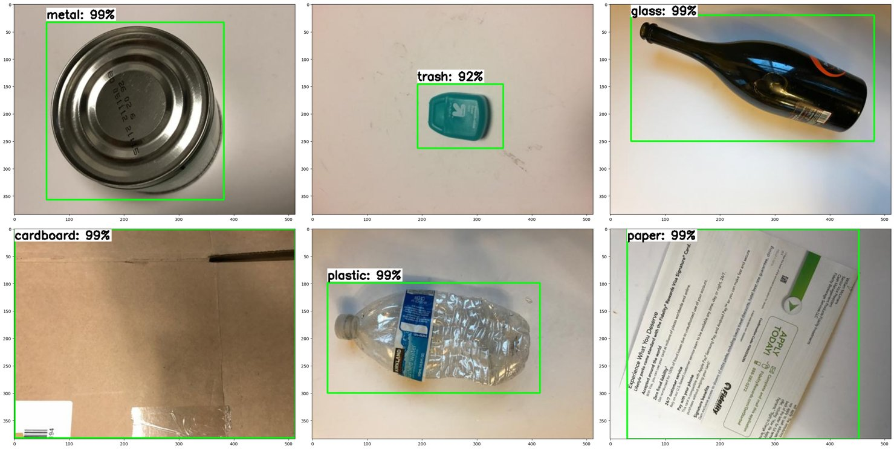

# Waste Sorting on Raspberry Pi 5

A conveyor that sorts waste into six classes: cardboard, glass, metal, paper,
plastic and trash. A camera on a Raspberry Pi 5 takes a picture of each item, a
TensorFlow Lite model classifies it, and a pneumatic actuator pushes it into
the right bin.

Paper: [Performance Evaluation of Deep Learning Models for Real-Time Trash
Classification on Embedded Devices](https://doi.org/10.1109/ICSPIS63676.2024.10812636),
IEEE ICSPIS 2024. See [Paper](#paper) for the citation.



Video of the system: [Dropbox](https://www.dropbox.com/scl/fi/gn2253p7blcot3ejch9rx/Trash-classifier-video.mp4?rlkey=lbdat4oshmrfep06salcrdqlg&e=1&st=50te1myi&dl=0)

## Why

Manual waste sorting is slow and error-prone, and mixed waste lowers the value
of recyclables. This project tests whether a low-cost embedded computer can
classify waste fast enough to sort it on a moving belt.

## How it works

1. An IR sensor detects an item at the camera and the conveyor starts.
2. The camera takes a frame. The frame is resized to 256 x 256 pixels, scaled
   to [0, 1], and classified by a TFLite model.
3. Each class has a delay that matches the time the item needs to travel from
   the camera to its bin. After the delay the actuator fires for 0.5 s.
4. Items classified as trash stay on the belt.

## Results

Classifiers were trained on TrashNet with TensorFlow and Keras, converted to
TensorFlow Lite, and run on a Raspberry Pi 5.

| Model | Accuracy | Inference time on Pi 5 | Frame rate on Pi 5 | Notes |
|---|---|---|---|---|
| EfficientNet B3 | 85.27% | 188 ms | 4.8 FPS | Best balance of accuracy and speed; used for deployment |
| MobileNetV2 | | 32 ms | 15 FPS | Fastest, but predictions were unstable |

EfficientNet B0 to B7, ResNet50 and DenseNet121 were also compared.

## Hardware

| Part | Notes |
|---|---|
| Raspberry Pi 5 (4 GB or 8 GB) | Runs `src/sorter.py` |
| Raspberry Pi HQ Camera (Sony IMX477, 12.3 MP) | Looks down at the belt |
| IR obstacle sensor | Output is low when an item is present |
| Conveyor belt with motor driver | TODO: motor and driver model |
| Pneumatic actuator with valve driver | TODO: actuator, valve and driver model |
| Power supply for the Pi 5, microSD card | |

### Pins

| Function | BCM GPIO | Physical pin | Direction |
|---|---|---|---|
| IR sensor | 17 | 11 | Input |
| Conveyor motor driver | 18 | 12 | Output |
| Pneumatic valve driver | 27 | 13 | Output |

The GPIO pins only give 3.3 V signals. Drive the motor and the valve through a
relay or driver board, never directly from the Pi.

### Timing

The delay for each class is set in `DELAY_MAP_S` in `src/sorter.py`:
cardboard 2.88 s, glass 4.44 s, metal 5.07 s, paper 7.53 s, plastic 8.81 s.
Each delay equals the distance from the camera to the bin in metres divided by
the belt speed in metres per second. If you change the belt speed or move a
bin, recompute the delay. TODO: record the belt speed and bin distances.

## Software

- Raspberry Pi OS (64-bit, Bookworm), Python 3.11
- Runtime packages: `requirements.txt`
- Training packages: `requirements-train.txt`, or Google Colab for the notebooks

## Install

On the Raspberry Pi:

```bash
git clone https://github.com/Fanuelpeter007/Waste-Sorting.git
cd Waste-Sorting
python -m venv .venv
source .venv/bin/activate
pip install -r requirements.txt
```

## Usage

### 1. Get the data

Download [TrashNet](https://github.com/garythung/trashnet) (MIT license) and
arrange it like this:

```
data/trashnet/train/cardboard/*.jpg ... data/trashnet/train/trash/*.jpg
data/trashnet/test/cardboard/*.jpg  ... data/trashnet/test/trash/*.jpg
```

### 2. Train and export a classifier

On a PC or in Colab:

```bash
pip install -r requirements-train.txt
python src/train_classifier.py --data data/trashnet --backbone efficientnet_b3 --epochs 20 --fine-tune 10
```

This writes `models/efficientnet_b3.tflite`. Copy it to the Pi as
`models/model.tflite`.

### 3. Measure speed on the Pi

```bash
python src/benchmark_tflite.py --model models/model.tflite
```

### 4. Run the sorter

```bash
python src/sorter.py --model models/model.tflite
```

Press q in the preview window or Ctrl+C to stop. The conveyor and actuator are
switched off on exit.

## Notebooks

| Notebook | What it does |
|---|---|
| `notebooks/tflite_ssd_detection_training.ipynb` | Trains an SSD MobileNet V2 FPNLite 320 object detector with the TensorFlow 2 Object Detection API in Colab, converts it to TFLite, quantizes it and evaluates mAP. Adapted from the [EdjeElectronics TFLite notebook](https://github.com/EdjeElectronics/TensorFlow-Lite-Object-Detection-on-Android-and-Raspberry-Pi). Needs images with Pascal VOC XML labels. |
| `notebooks/pytorch_resnet50_classification.ipynb` | Earlier PyTorch experiment: a small CNN and a pretrained ResNet50 classifier, trained in Colab from Google Drive. |

The detection model outputs boxes, classes and scores. It is not a drop-in
replacement for the classifier that `src/sorter.py` uses.

## Project structure

```
docs/images/   Example detections
models/        Trained models (not in git, see models/README.md)
notebooks/     Colab training notebooks
src/           Sorter, classifier training and benchmark scripts
```

## Limitations

- The sorter waits for each item to reach its bin before it takes the next
  picture, so items must be spaced out on the belt.
- `src/sorter.py` reads the camera through OpenCV (`cv2.VideoCapture`). TODO:
  confirm how the HQ camera was exposed to OpenCV on the Pi 5.
- The mAP step in the detection notebook reports 0% AP for metal, paper,
  plastic and trash, while the sample detections show these classes found
  correctly. The evaluation needs to be re-run before its numbers are used.
- The PyTorch notebook applies a sigmoid before the cross-entropy loss, and its
  saved outputs stop after 3 of the 100 planned epochs.
- TrashNet photos show one item on a plain background. Real waste on a belt is
  more varied, so accuracy in use will likely be lower.

## Paper

A. Ahmed, F. Petros, T. Yemane, F. Flitti and Y. Benachour, "Performance
Evaluation of Deep Learning Models for Real-Time Trash Classification on
Embedded Devices," *2024 7th International Conference on Signal Processing and
Information Security (ICSPIS)*, Dubai, United Arab Emirates, 2024, pp. 1-6,
doi: [10.1109/ICSPIS63676.2024.10812636](https://doi.org/10.1109/ICSPIS63676.2024.10812636).

If you use this work, please cite:

```bibtex
@inproceedings{Ahmed_2024,
  title     = {Performance Evaluation of Deep Learning Models for Real-Time Trash Classification on Embedded Devices},
  author    = {Ahmed, Abduselam and Petros, Fanuel and Yemane, Tomas and Flitti, Farid and Benachour, Yassine},
  booktitle = {2024 7th International Conference on Signal Processing and Information Security (ICSPIS)},
  publisher = {IEEE},
  year      = {2024},
  month     = nov,
  pages     = {1--6},
  doi       = {10.1109/ICSPIS63676.2024.10812636}
}
```

## Credits

- Dataset: [TrashNet](https://github.com/garythung/trashnet) by Gary Thung and Mindy Yang (MIT license)
- Detection notebook adapted from [EdjeElectronics](https://github.com/EdjeElectronics/TensorFlow-Lite-Object-Detection-on-Android-and-Raspberry-Pi) (Evan Juras)

## License

[MIT](LICENSE)
